# Práctica 4. Gestión Avanzada de Ramas y Resolución de Conflictos

## 1. Contexto

Eres parte del equipo de desarrollo de "WebNova", un proyecto web emergente. El equipo utiliza Git para gestionar versiones y desarrollar nuevas funcionalidades de forma paralela sin afectar la rama principal estable. Tu misión es simular el flujo de trabajo de un equipo, gestionando ramas locales, integrando funcionalidades y resolviendo conflictos de forma ordenada.

## 2. Objetivos

- Comprender la creación, navegación y gestión de ramas locales.
- Ejecutar fusiones (merges) limpias (Fast-Forward) y a tres bandas (3-Way Merge).
- Identificar, interpretar y resolver conflictos de fusión manualmente.
- Mantener un historial de proyecto estructurado y limpio.
- Representar visualmente la evolución del repositorio.

## 3. Preparación del Entorno (Fase Base)

1. Crea un directorio para el proyecto y accede a él:

   ```bash
   mkdir webnova
   cd webnova
   ```

   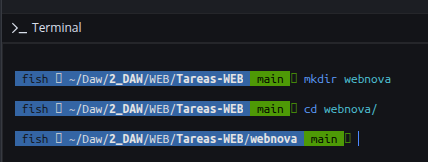

2. Asegúrate de configurar la rama predeterminada como main e inicializa el repositorio:

   ```bash
   git config --global init.defaultBranch main
   git init
   ```

   _Esta parte no ha sido necesaria, ya que el repositorio lo he iniciado con GitKraken, y ya tenia configurado de ejercicios anteriores el main_

3. Crea el archivo base `index.html` con la estructura inicial:

   ```html
   <h1>Bienvenido a WebNova</h1>
   <p>Versión inicial del proyecto</p>
   ```

   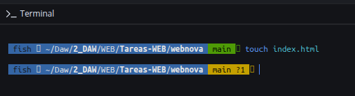

   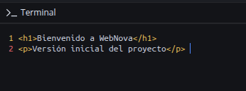

4. Añade y confirma el archivo:

   ```bash
   git add .
   git commit -m "C1: Versión inicial de WebNova"
   ```

   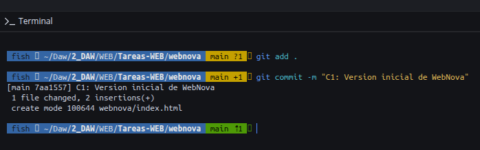

## 4. Desarrollo del Proyecto

### PARTE 1: Desarrollo en Paralelo

1. Creación de ramas de características: Simularemos el desarrollo de tres componentes distintos creando tres ramas a partir de main:

   ```bash
   git branch cabecera
   git branch contenido
   git branch pie
   ```

   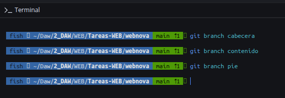

2. Comprueba que las ramas se han creado y que te encuentras en main:

   ```bash
   git branch
   ```

   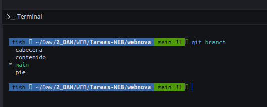

3. Desarrollo en la rama cabecera: Cámbiate a la rama usando el comando moderno:

   ```bash
   git switch cabecera
   ```

   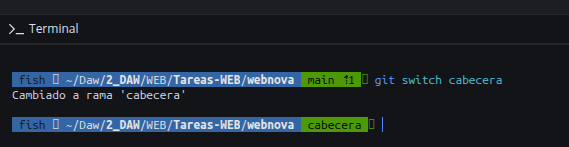

4. Crea el archivo `header.html`:

   ```html
   <header>
     <h2>WebNova - Innovación en la web</h2>
     <nav>
       <a href="#">Inicio</a> | <a href="#">Servicios</a> |
       <a href="#">Contacto</a>
     </nav>
   </header>
   ```

   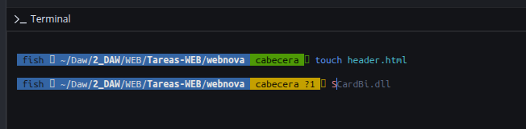

   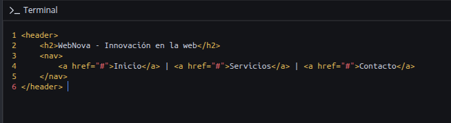

5. Añade y confirma:

   ```bash
   git add header.html
   git commit -m "C2: Añadido encabezado con navegación"
   ```

   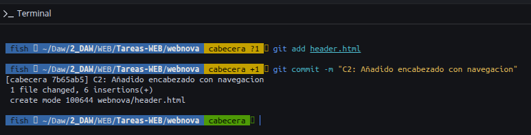

6. Desarrollo en la rama contenido:

   ```bash
   git switch contenido
   ```

   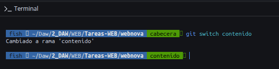

7. Crea el archivo `content.html`:

   ```html
   <main>
     <h3>Nuestros servicios</h3>
     <p>Ofrecemos soluciones de desarrollo web a medida.</p>
   </main>
   ```

   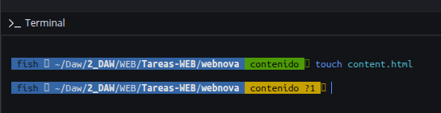

   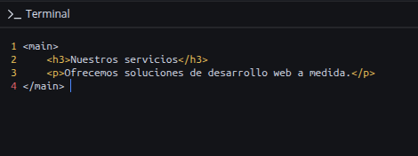

8. Confirma los cambios:

   ```bash
   git add content.html
   git commit -m "C3: Creado contenido principal"
   ```

   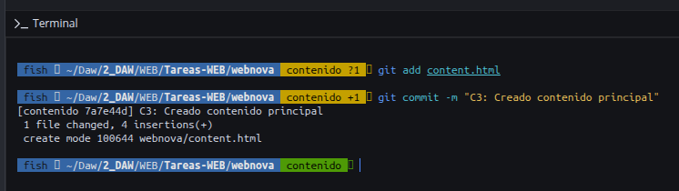

9. Desarrollo en la rama pie:

   ```bash
   git switch pie
   ```

   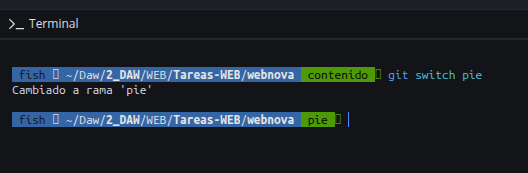

10. Crea el archivo `footer.html`:

    ```html
    <footer>
      <p>&copy; 2026 WebNova. Todos los derechos reservados.</p>
    </footer>
    ```

    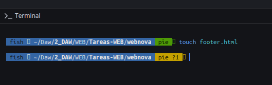

    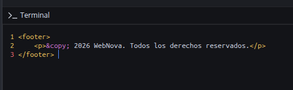

11. Confirma los cambios:

    ```bash
    git add footer.html
    git commit -m "C4: Añadido pie de página"
    ```

    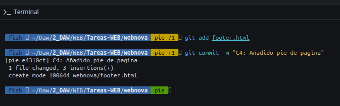

### PARTE 2: Integración (Fusiones sin conflicto)

Es momento de ensamblar los componentes.

1. Vuelve a la rama principal:

   ```bash
   git switch main
   ```

   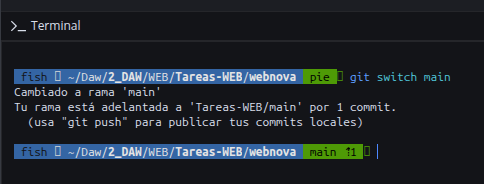

2. Fusiona las ramas de desarrollo una a una. (Observa en la consola qué tipo de fusión realiza Git en cada caso):

   ```bash
   git merge cabecera
   git merge contenido
   git merge pie
   ```

   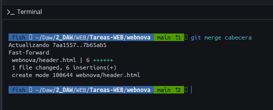

   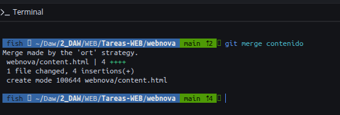

   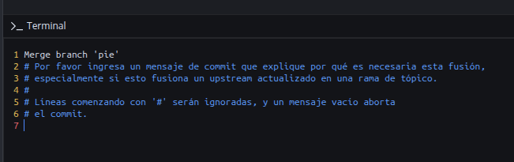

   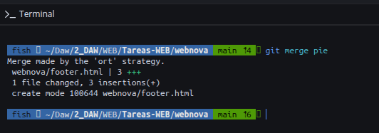

3. Ahora que los tres archivos (`header.html`, `content.html`, `footer.html`) existen en la rama main, actualiza tu `index.html` para unificar el código (puedes copiar el contenido de los tres archivos dentro de `index.html`).

   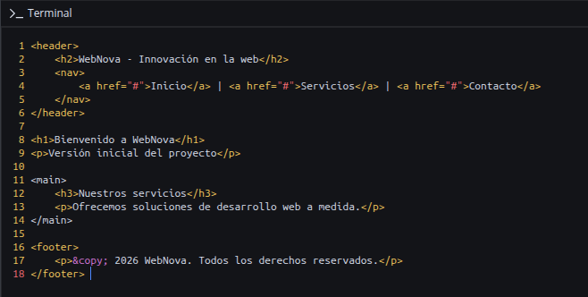

4. Haz un commit de consolidación:

   ```bash
   git commit -a -m "C5: Integrados cabecera, contenido y pie en index.html"
   ```

   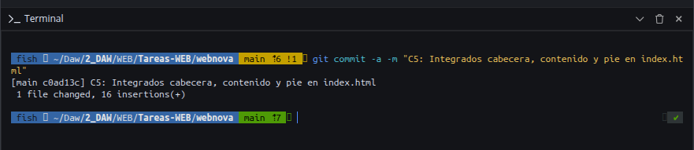

5. Limpieza: Elimina las tres ramas de desarrollo, ya que han cumplido su propósito:

   ```bash
   git branch -d cabecera contenido pie
   ```

   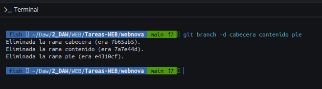

### PARTE 3: Provocando y Resolviendo un Conflicto

1. La rama de rediseño: Crea y salta inmediatamente a una nueva rama llamada rediseño:

   ```bash
   git switch -c rediseño
   ```

   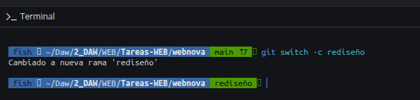

2. Modifica la etiqueta `<h1>` en `index.html` para que quede así:

   ```html
   <h1>WebNova - Sitio oficial (Rediseño 2026)</h1>
   ```

   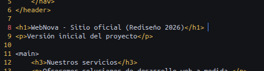

3. Confirma el cambio:

   ```bash
   git commit -a -m "C6: Rediseño del título principal"
   ```

   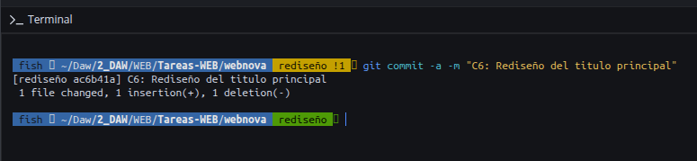

4. Trabajo divergente en main: Vuelve a la rama main:

   ```bash
   git switch main
   ```

   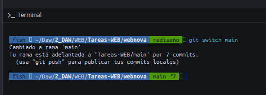

5. Imagina que otro compañero modificó simultáneamente esa misma línea en main. Cambia el `<h1>` en `index.html` a:

   ```html
   <h1>WebNova - Portal principal corporativo</h1>
   ```

   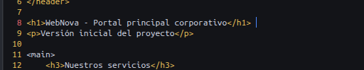

6. Confirma el cambio:

   ```bash
   git commit -a -m "C7: Cambio de título corporativo en main"
   ```

   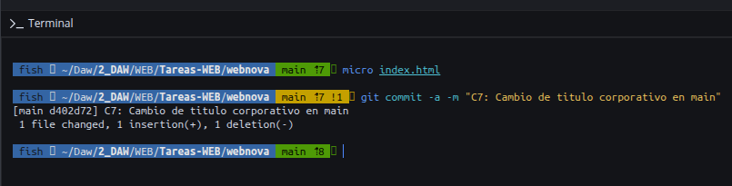

7. La Fusión y el Conflicto: Intenta integrar el rediseño en la rama principal:

   ```bash
   git merge rediseño
   ```

   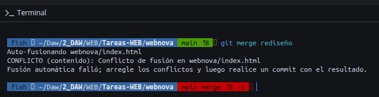

8. Git pausará la fusión alertando de un conflicto de contenido.

9. Resolución: Abre `index.html` en tu editor. Identifica las marcas de conflicto (`<<<<<<<`, `=======`, `>>>>>>>`). Edita el archivo, elimina las marcas de Git y fusiona ambas ideas para dejar la línea final así:

   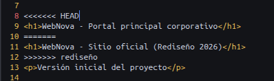

   ```html
   <h1>WebNova - Portal principal (Rediseño 2026)</h1>
   ```

   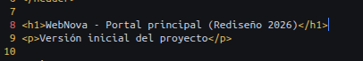

10. Guarda, prepara el archivo y finaliza la fusión:

    ```bash
    git add index.html
    git commit -m "C8: Conflicto resuelto entre main y rediseño en el H1"
    ```

    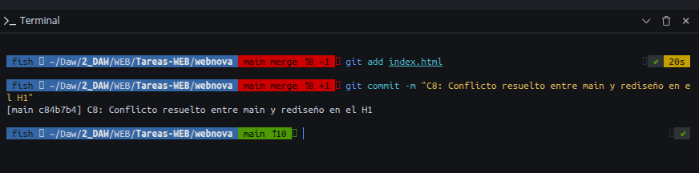

### PARTE 4: Visualización del Historial

Para comprobar que todas las ramas y fusiones se han registrado correctamente, ejecuta:

```bash
git log --oneline --graph --all
```

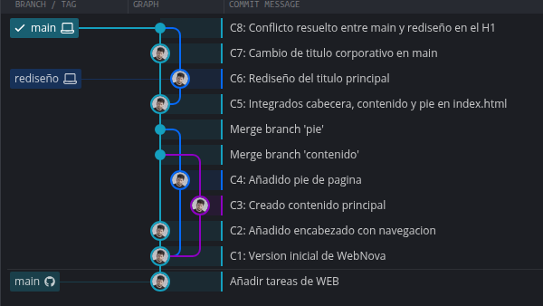

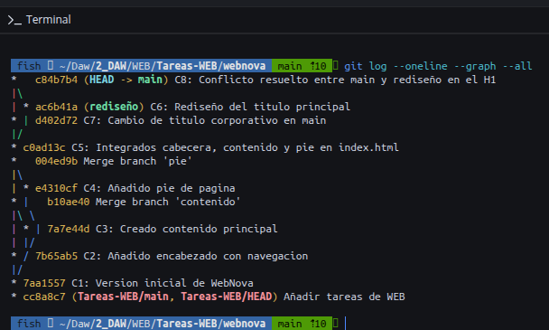

## 5. Reflexión teórica (Breve):

- ¿Por qué ocurrió el conflicto en la PARTE 3 y por qué no ocurrió en la PARTE
  2?
  <br>
  _En la parte 3 hubo un conflicto porque, al hacer el merge, teníamos la misma línea del archivo modificada en main y en rediseño, y Git no sabía cuál de las dos dejar, en la parte 2 no pasó porque eran archivos diferentes._
  <br>
  <br>
- Al ejecutar git switch main en la PARTE 3.2, ¿qué ocurrió con los archivos
  de tu directorio de trabajo?
  <br>
  _Al cambiar a la rama main, los cambios que hicimos en la rama rediseño no estan, porque main tiene su propria version delos archivos, los cambios seguían guardados en rediseño_
